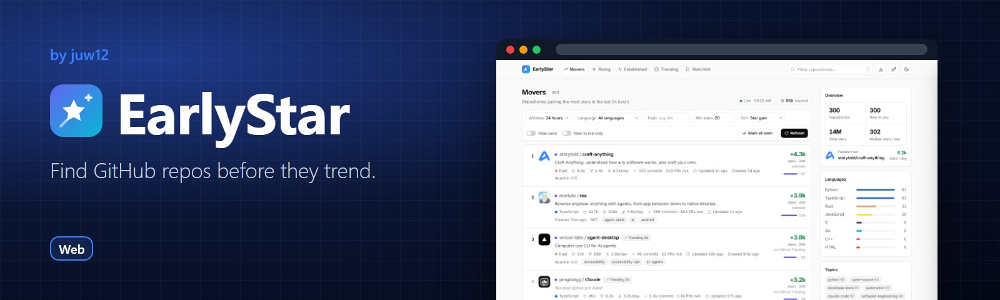
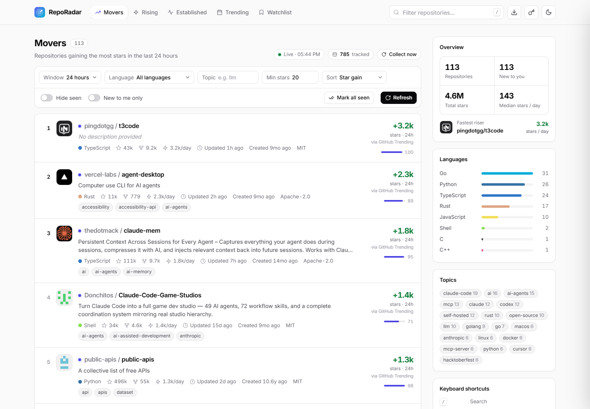

<!-- HERO:START -->
<p align="center">
  <a href="https://juw12.github.io/reporadar/"></a>
</p>

<p align="center">
  <b>Find GitHub repos before they trend.</b><br>
  See the repos gaining stars fastest right now, filter them in seconds and keep a watchlist.
</p>

<p align="center">
  <a href="https://juw12.github.io/reporadar/"><b>Try it live</b></a> ·
  <a href="#see-it-in-action">See it in action</a> ·
  <a href="#highlights">Highlights</a> ·
  <a href="https://github.com/juw12">More by juw12</a>
</p>

<p align="center">
  <a href="https://github.com/juw12/reporadar"></a>
  <a href="https://juw12.github.io/reporadar/"></a>
  
  
</p>

<a id="highlights"></a>
<table>
  <tr>
    <td width="33%" valign="top">
      <b>Movers and rising</b><br>
      Repos gaining the most stars in the last 24 hours, ranked.
    </td>
    <td width="33%" valign="top">
      <b>Filter fast</b><br>
      Narrow the list by language, stars and age.
    </td>
    <td width="33%" valign="top">
      <b>Watchlist</b><br>
      Keep an eye on repos before everyone else does.
    </td>
  </tr>
</table>

## See it in action

<p align="center">
  <a href="https://juw12.github.io/reporadar/"></a><br>
  <sub>Open the interactive demo at <a href="https://juw12.github.io/reporadar/">juw12.github.io/reporadar/</a></sub>
</p>
<!-- HERO:END -->

## About

**Find GitHub repos before they trend.** Live at **[juw12.github.io/reporadar](https://juw12.github.io/reporadar/)**.


RepoRadar tracks GitHub Trending and fast-rising new repositories, keeps its own star history, and ranks repos by the stars they actually gained.

- **Movers**: biggest real star gains in 24 h / 7 d / 30 d, with the source of every number shown (tracked by RepoRadar, a brand-new repo, GitHub Trending's own count, or an estimate).
- **Rising**: brand-new repos ranked by stars per day and a momentum score.
- **Trending log**: a day-by-day archive of GitHub Trending with streaks and appearance counts.
- **Repo details**: star-history chart, Trending appearances, language breakdown, README, and exact 24 h / 7 d gains from stargazer timestamps (with your own GitHub token).
- **Activity, not just stars**: commits, merged PRs, new issues (last 7 days) and the latest release for the hottest repos, so hype can be told apart from a project that's actually shipping.
- **README badges + open JSON API**: every tracked repo gets a live badge and all data is plain JSON (see below).
- **Discovery tools**: "new to me" and "hide seen", a watchlist, side-by-side compare, CSV export, keyboard shortcuts, light and dark themes.

## Badge for your README

Open any repo on RepoRadar and copy the snippet from its details panel, or build it yourself:

```markdown
[](https://juw12.github.io/reporadar/#repo=OWNER/NAME)
```

It shows `#3 today · +3.8k★` while the repo is a top-100 mover, `+X★ this week` otherwise, and falls back to the total stars.

## JSON API

Static files on GitHub Pages, refreshed every 30 minutes, CORS-friendly, no key needed. Base URL: `https://juw12.github.io/reporadar/data/`

| File | What's in it |
| --- | --- |
| `health.json` | Last collection time and counts |
| `movers-24h.json`, `movers-7d.json`, `movers-30d.json` | Ranked star gains (`items[]` with `gain`, `gain_source`, `engagement`, …) |
| `trending/days.json` | Days with a recorded GitHub Trending snapshot |
| `trending/YYYY-MM-DD.json` | That day's Trending lists, keyed `since\|language` |
| `repos.json` | `owner/name` → repo id |
| `history/{id}.json` | Star/fork snapshots, Trending appearances and activity for one repo |
| `badge/{owner}/{name}.json` | shields.io endpoint payload |

## How it works

A GitHub Action (`.github/workflows/collect.yml`) runs every 30 minutes (at :07 and :37, away from the busy top of the hour):

1. `collector.py` scrapes GitHub Trending and runs a few search queries, saving star snapshots into SQLite, then fetches 7-day activity for the hottest repos via one batched GraphQL query.
2. The database is kept on the `data` branch (one commit, overwritten each run, so history doesn't bloat the repo).
3. `export_static.py` turns the history into JSON files and badges, and the site is deployed to GitHub Pages.

`index.html` is a single file with no build step. It reads those JSON files on GitHub Pages, talks to `server.py` when run locally, and still works opened straight from disk (Rising / Established / Watchlist only).

## Run it locally

```bash
python server.py --open      # http://127.0.0.1:8765, collects every 30 min
```

Python 3.10+ standard library only, nothing to install. Set `GITHUB_TOKEN` for higher GitHub API limits.

MIT licensed.
